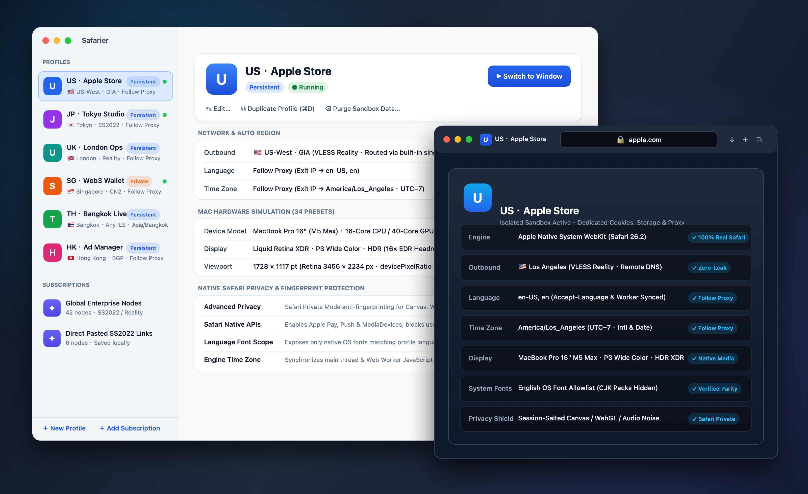
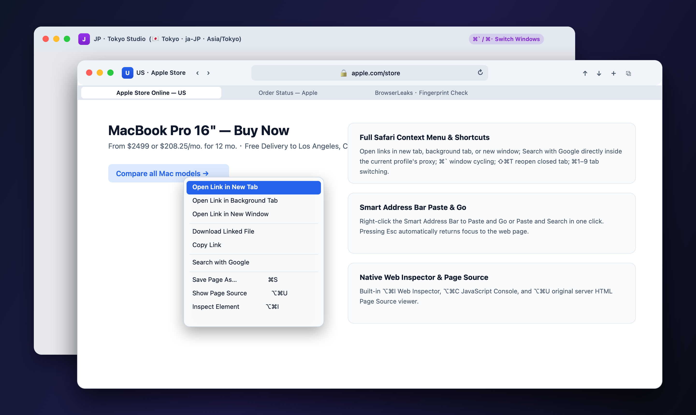

<div align="center">
  
  <h1>Safarier</h1>
  <p><strong>The Native Safari Multi-Environment Browser for macOS</strong></p>
  <p>Run dozens of isolated accounts side-by-side — powered by Apple's real Safari engine, Safari Private Browsing protection, 34 authentic Mac hardware presets, and built-in global proxy routing.</p>
  <p>
    <a href="https://github.com/Cd1s/safarier/releases/latest"></a>
    
    
    
    <a href="https://linux.do"></a>
  </p>
  <p>
    <strong>English</strong> · <a href="README.zh-CN.md">简体中文</a>
  </p>
</div>

<div align="center">
  
</div>

---

## Why Safarier?

Most multi-account or "fingerprint" browsers on the market are built on modified versions of Chrome that try to fake hardware parameters using injected scripts. Modern websites can easily detect those fake scripts.

**Safarier takes a fundamentally different approach:**

- **100% Real macOS Safari Engine**: Every Safarier window runs on Apple's native system `WebKit` engine. To any website, your connection signature, rendering engine, and system behavior are genuinely macOS Safari.
- **Safari Private Browsing Grade Protection**: Uses Apple's native anti-fingerprinting shield to protect Canvas, WebGL, and Audio signatures naturally — zero fake scripts, zero browser extensions required.
- **Complete Account Isolation**: Each environment runs in its own separate process and storage space. Cookies, login sessions, local storage, cache, and proxy routes never cross over between environments.

<div align="center">
  
</div>

---

## Download & Install

Choose the package for your Mac from [GitHub Releases](https://github.com/Cd1s/safarier/releases/latest) (supports **macOS 14 Sonoma**, **macOS 15 Sequoia**, and later):

| Edition | Recommended For | Download Package |
|---|---|---|
| **Apple Silicon** | Mac with **Apple Silicon** chip | [**`Safarier-v1.2.1-macOS-arm64.zip`**](https://github.com/Cd1s/safarier/releases/latest) |
| **Intel** | Intel-based Mac | [**`Safarier-v1.2.1-macOS-x86_64.zip`**](https://github.com/Cd1s/safarier/releases/latest) |
| **Universal** | Works on both Apple Silicon & Intel Macs | [**`Safarier-v1.2.1-macOS-universal.zip`**](https://github.com/Cd1s/safarier/releases/latest) |

1. Unzip the downloaded file and drag **`Safarier.app`** into your **`Applications`** folder.
2. If macOS prompts that the app cannot be verified on first launch, run this single command in Terminal:
   ```bash
   xattr -dr com.apple.quarantine /Applications/Safarier.app
   ```

---

## What Environments Can Safarier Simulate?

| Capability | What It Does for You |
|---|---|
| **Independent Account Spaces** | Create unlimited **Persistent** spaces (stay logged in forever) or **Temporary Private** spaces (auto-wiped when closed). Press **`⌘D`** to clone any environment in one click. |
| **34 Real Mac Models** | Simulate **MacBook Pro 16" & 14"** (Apple Silicon XDR), **MacBook Air 15" & 13"**, **iMac 24" 4.5K**, **Mac Studio (5K Studio Display)**, **Mac mini (4K Retina)**, and **Mac Pro (6K XDR)** — complete with matching Retina ratio, P3 wide color, and HDR display traits. |
| **Auto Follow-Proxy Region** | Simply select a proxy node (US, Japan, UK, Singapore, Hong Kong, Taiwan, Thailand, etc.) and Safarier automatically matches your browser **Language** and **Time Zone** to your exit IP's country and city. |
| **Real Mac Font Isolation** | Enabled by default: blocks user-installed third-party fonts and keeps built-in system fonts, including baseline CJK families, while filtering additional downloaded language assets according to your environment's language. |
| **Built-in All-Protocol Proxy** | No external proxy client needed. Paste a subscription URL or paste node links (`VLESS` / `Reality`, `VMess`, `Trojan`, `Shadowsocks` / `SS2022`, `AnyTLS`, `SOCKS5`, `HTTP`) directly. |
| **Zero-Leak Protection** | Every environment routes traffic and DNS strictly through its assigned node. If a proxy disconnects, page loading stops immediately and **never** falls back to your real local IP. |

---

## Authentic Safari Browsing Experience

<div align="center">
  
</div>

Safarier is designed to feel right at home for every Mac and Safari user:

- **Unified Safari Toolbar & Smart Address Bar**: Displays the current environment badge, security lock, loading progress, and supports right-click **Paste and Go / Paste and Search**.
- **Complete Safari Right-Click Menu**: Open links, images, videos, or frames in a new tab, background tab, or new window; save pages; inspect elements; or highlight text and **Search with Google directly inside the current environment's proxy** (never jumping out to your system default browser).
- **Seamless Multi-Window & Multi-Tab Workflow**: Native macOS tabs, tab overview grid, and instant **`⌘\`` / `⌘·`** switching across multiple windows and environments.

### Essential Shortcuts

| Action | Shortcut | Action | Shortcut |
|---|---|---|---|
| **New Tab / New Window** | `⌘T` / `⌘N` | **Switch Windows (EN & CN IME)** | `⌘\`` / `⌘·` |
| **Reopen Last Closed Tab** | `⇧⌘T` | **Switch to Tab 1–8 / Last Tab** | `⌘1`–`⌘8` / `⌘9` |
| **Close Tab / Close Other Tabs** | `⌘W` / `⌥⌘W` | **Next / Previous Tab** | `⇧⌘]` / `⇧⌘[` |
| **Focus Address Bar** | `⌘L` | **Show All Tabs Overview** | `⇧⌘\` |
| **Reload / Force Reload** | `⌘R` / `⌥⌘R` | **Zoom Page / Zoom Text Only** | `⌘+` `⌘-` / `⌥⌘+` `⌥⌘-` |
| **Find on Page / Use Selection** | `⌘F` / `⌘E` | **Web Inspector / Page Source** | `⌥⌘I` / `⌥⌘U` |
| **Save Page / Export PDF** | `⌘S` / `⌘P` | **Show Downloads** | `⌥⌘L` |

---

## Built for AI Agents

Control each profile through a local, owner-only CLI bridge: semantic snapshots with element references and viewport coordinates, framework-friendly form filling, character-by-character OTP input, visible-element waits, native coordinate clicks, screenshots, and tab management. Page interactions run in an isolated client world and preserve the page's JavaScript globals.

Opening the manager synchronizes the **safarier-browser** Skill to `~/.claude/skills`, `~/.claude-ifrr/skills`, and `~/.agents/skills`. Reload Skill discovery in Claude Code or Codex, or use **AI Agent → AI Agent 接入…** to copy the guide for another client. Cursor and OpenCode may need manual import according to their Skill support.

```sh
SF=/Applications/Safarier.app/Contents/MacOS/Safarier
"$SF" agent spaces
"$SF" agent open "Test Space" https://example.com --background
"$SF" agent snapshot "Test Space"
"$SF" agent fill "Test Space" e1 user@example.com
"$SF" agent click "Test Space" e2
"$SF" agent wait "Test Space" 'input[autocomplete="one-time-code"]'
"$SF" agent type "Test Space" 'input[autocomplete="one-time-code"]' 123456
"$SF" agent screenshot "Test Space" /tmp/page.png
"$SF" agent focus "Test Space"
```

Use `agent eval` to batch asynchronous steps with `safarier.fill`, `safarier.type`, `safarier.waitFor`, and `safarier.snapshot`; use `agent skill` for the full guide. Different profiles can run concurrently. The `123456` code above is test data: supply only a code you are authorized to use.

This supports authorized form testing and assisted registration. CAPTCHA challenges, passkey confirmation, and other human verification remain a human handoff through `agent focus`; no CAPTCHA solver is included. DOM helpers generate synthetic events; native coordinate clicks dispatch through AppKit, which does not guarantee acceptance by a website. A successful command should be followed by a snapshot to verify the result.

---

## Contributing

Bug reports, feature requests and pull requests are welcome — please use the issue forms and the PR checklist. Before changing code, read the [Contributing Guide](CONTRIBUTING.md): the core rules (zero JS injection, runtime-verified Native Engine Bridge capabilities with safe fallback, fail-closed proxies), the project layout, and how to verify changes with `swift test` and `safarier probe`.

---

## License & Acknowledgments

Safarier is built natively with Swift and Apple WebKit for macOS. `Safarier.app` bundles an unmodified Universal helper build of [SagerNet/sing-box](https://github.com/SagerNet/sing-box) (GPL-3.0-or-later) for multi-protocol proxy routing; full license notices are included inside the application bundle under `Contents/Resources/ThirdParty/sing-box/`.

- Community & Links: [LINUX DO](https://linux.do)

