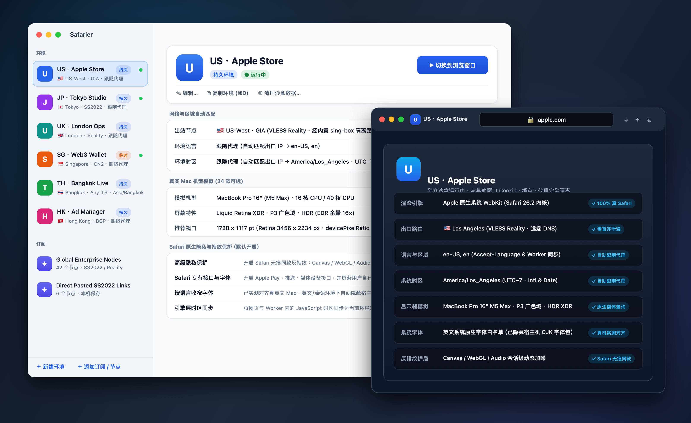
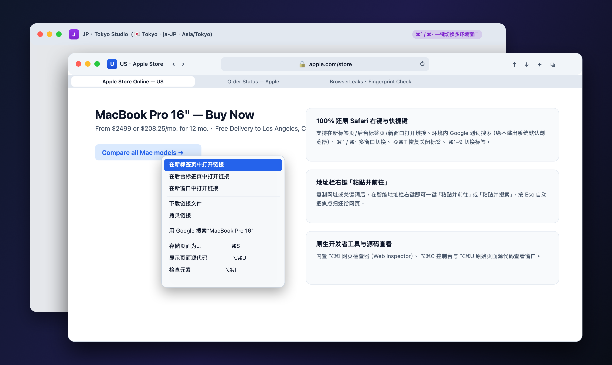

<div align="center">
  
  <h1>Safarier</h1>
  <p><strong>专为 macOS 打造的原生 Safari 多环境指纹浏览器</strong></p>
  <p>基于 Apple 真 Safari 内核与 Safari 无痕隐私护盾构建 — 支持多账号独立沙盒、34 款真实 Mac 机型模拟、语言时区自动跟随代理、内置全协议订阅引擎。</p>
  <p>
    <a href="https://github.com/Cd1s/safarier/releases/latest"></a>
    
    
    
    <a href="https://linux.do"></a>
  </p>
  <p>
    <a href="README.md">English</a> · <strong>简体中文</strong>
  </p>
</div>

<div align="center">
  
</div>

---

## 为什么选择 Safarier？

市面上绝大多数指纹浏览器都是基于 Chromium 魔改，靠往网页里注入脚本来伪造硬件信息，极易被风控系统识破“篡改痕迹”。

**Safarier 走的是完全不同的原生路线：**

- **100% 真 macOS Safari 内核**：直接调用苹果系统原生 `WebKit` 渲染引擎。在任何网站看来，你的网络握手、渲染管线、系统特征就是一台真实的 Mac Safari。
- **Safari 无痕级原生隐私护盾**：默认开启苹果原生的反指纹保护，对 Canvas、WebGL、Audio 采样按会话自然加噪，不注入一行篡改代码，天然融入真实 Mac 用户群。
- **多账号彻底物理隔离**：每个环境都在独立进程与专属沙盒中运行，Cookie、登录状态、本地缓存、代理通道彼此完全隔离，互不串号。

<div align="center">
  
</div>

---

## 下载与安装

前往 [Releases 页面](https://github.com/Cd1s/safarier/releases/latest) 下载适合你 Mac 的版本（支持 **macOS 14 Sonoma**、**macOS 15 Sequoia** 及以上系统）：

| 版本 | 适用电脑 | 下载安装包 |
|---|---|---|
| **Apple Silicon 版** | 搭载 **Apple Silicon** 芯片的 Mac | [**`Safarier-v1.2.4-macOS-arm64.zip`**](https://github.com/Cd1s/safarier/releases/latest) |
| **Intel 版** | 搭载 **Intel** 处理器的 Mac | [**`Safarier-v1.2.4-macOS-x86_64.zip`**](https://github.com/Cd1s/safarier/releases/latest) |
| **Universal 通用版** | 双架构合一（Apple Silicon 与 Intel 通用） | [**`Safarier-v1.2.4-macOS-universal.zip`**](https://github.com/Cd1s/safarier/releases/latest) |

1. 解压下载的压缩包，将 **`Safarier.app`** 拖入「**应用程序**」（`/Applications`）文件夹。
2. 首次打开如果系统弹出安全提示，在「终端」粘贴运行这一行命令即可正常打开：
   ```bash
   xattr -dr com.apple.quarantine /Applications/Safarier.app
   ```

---

## Safarier 能为你模拟什么环境？

| 核心能力 | 实际效果与优势 |
|---|---|
| **多环境隔离与一键复制** | 支持 **持久环境**（长期保持账号登录态）与 **临时无痕环境**（关窗即焚）。支持右键或按 **`⌘D`** 一键复制环境配置，秒开新沙盒。 |
| **34 款真实 Mac 机型模拟** | 内置 **MacBook Pro 16" & 14"**（Apple Silicon XDR）、**MacBook Air 15" & 13"**、**iMac 24" 4.5K**、**Mac Studio（搭配 5K Studio Display）**、**Mac mini（4K Retina）**、**Mac Pro（搭配 6K Pro Display XDR）** 真实预设，自动对齐视口比例、Retina 像素比、P3 广色域与 HDR 屏幕特性。 |
| **语言与时区自动跟随代理** | 开启「**跟随代理**」后，连接美国、日本、英国、新加坡、香港、台湾、泰国等任意节点，启动时自动识别出口 IP 所在国家与城市，自动匹配对应的网页语言与系统时区。 |
| **真机级系统字体隔离** | 默认开启：自动屏蔽用户安装的第三方字体，保留系统卷自带字体（包括基础中日韩字体），仅按环境语言过滤额外下载的字体资产；英文环境也保留冬青黑体、宋体等基础字体。 |
| **内置全协议代理引擎** | 无需额外开启代理软件。支持直接导入机场订阅链接，或直接粘贴单条/多条节点链接（全面支持 `VLESS` / `Reality`、`VMess`、`Trojan`、`Shadowsocks` / `SS2022`、`AnyTLS`、`SOCKS5`、`HTTP`）。 |
| **断连阻断，零真实 IP 泄漏** | 每个环境的网页请求与 DNS 解析强制走该环境的独立代理通道；如果节点断开，页面立即停止加载，绝不静默退回本机网络。 |

---

## 深度还原真 Safari 浏览体验

<div align="center">
  
</div>

Safarier 完整还原了你在 Mac 上最顺手的 Safari 操作习惯：

- **统一工具栏与智能地址栏**：左侧显示当前环境标识，居中地址栏支持安全锁展示、加载进度条，右键支持一键「**粘贴并前往 / 粘贴并搜索**」。
- **完整 Safari 右键菜单**：支持在新标签页、后台标签页或新窗口打开链接/图片/视频；选中文字点击「**用 Google 搜索**」会直接在**当前环境的代理与新标签页**中打开，绝不跳出到系统默认浏览器。
- **多窗口与多标签丝滑切换**：支持 macOS 原生标签栏、标签拖拽合并、标签概览网格，以及按 **`⌘\`` / `⌘·`**（兼容中英文输入法）在多个窗口与不同环境之间一键切换。

### 常用快捷键速查

| 功能 | 快捷键 | 功能 | 快捷键 |
|---|---|---|---|
| **新建标签页 / 新建窗口** | `⌘T` / `⌘N` | **循环切换窗口（支持中文输入法）** | `⌘\`` / `⌘·` |
| **恢复刚关闭的标签页** | `⇧⌘T` | **切换到第 1–8 个 / 最后一个标签** | `⌘1`–`⌘8` / `⌘9` |
| **关闭标签页 / 关闭其他标签页** | `⌘W` / `⌥⌘W` | **下一个 / 上一个标签页** | `⇧⌘]` / `⇧⌘[` |
| **聚焦地址栏** | `⌘L` | **显示所有标签页概览** | `⇧⌘\` |
| **重新载入 / 忽略缓存刷新** | `⌘R` / `⌥⌘R` | **缩放页面 / 仅缩放文字** | `⌘+` `⌘-` / `⌥⌘+` `⌥⌘-` |
| **页内查找 / 用所选内容查找** | `⌘F` / `⌘E` | **网页检查器 / 显示页面源代码** | `⌥⌘I` / `⌥⌘U` |
| **存储页面为 / 打印与导出 PDF** | `⌘S` / `⌘P` | **查看下载项** | `⌥⌘L` |

---

## AI Agent 自动化接入（Built for AI Agents）

每个环境提供本地、仅当前用户可访问的 CLI 桥接：带元素引用与视口坐标的语义快照、适配受控表单的填充、OTP 逐字符输入、可见元素等待、原生坐标点击、截图和标签页管理。页面操作在隔离的客户端脚本世界执行，不向网页自身的 JavaScript 全局对象添加工具变量。

打开管理器后，会自动将 **safarier-browser** Skill 同步到 `~/.claude/skills`、`~/.claude-ifrr/skills` 和 `~/.agents/skills`。在 Claude Code / Codex 中重新加载技能列表即可使用；也可点击管理器的 **AI Agent 接入** 按钮拷贝完整指南。Cursor、OpenCode 等客户端请按各自的 Skill 支持方式导入。

```sh
SF=/Applications/Safarier.app/Contents/MacOS/Safarier
"$SF" agent spaces
"$SF" agent open "测试环境" https://example.com --background
"$SF" agent snapshot "测试环境"
"$SF" agent fill "测试环境" e1 user@example.com
"$SF" agent click "测试环境" e2
"$SF" agent wait "测试环境" 'input[autocomplete="one-time-code"]'
"$SF" agent type "测试环境" 'input[autocomplete="one-time-code"]' 123456
"$SF" agent screenshot "测试环境" /tmp/page.png
"$SF" agent focus "测试环境"
```

通过 `agent eval` 可用 `safarier.fill`、`safarier.type`、`safarier.waitFor` 和 `safarier.snapshot` 批量执行异步步骤；`agent skill` 输出完整用法。不同环境可并行操作。示例中的 `123456` 是测试数据，实际使用应填入本人或获授权的验证码。

支持获授权的表单测试与辅助注册。遇到图形验证码、通行密钥确认等人工验证时，通过 `agent focus` 唤起窗口交给用户完成；不包含验证码破解功能。DOM 工具产生合成事件，原生坐标点击经 AppKit 分发，网站是否接受仍需检查页面结果。执行成功后应重新截图或读取快照确认。

---

## 参与贡献与开发手册

欢迎提交问题反馈、功能建议和 Pull Request，请使用仓库里的 Issue 表单和 PR 检查清单。改代码之前请先读 [开发手册](CONTRIBUTING.zh-CN.md)：核心红线（零 JS 注入、原生引擎桥接层先做运行时方法签名与能力核验并能安全降级、代理 Fail-Closed）、代码结构，以及怎么用 `swift test` 和 `safarier probe` 验证改动。

---

## 开源声明与友链

Safarier 基于 Swift 与 Apple 原生 WebKit 构建。应用内附带未修改的 [SagerNet/sing-box](https://github.com/SagerNet/sing-box)（GPL-3.0-or-later）Universal 辅助程序用于多协议节点路由，完整许可证位于应用包内 `Contents/Resources/ThirdParty/sing-box/`。

- 社区与友链：[LINUX DO](https://linux.do)

